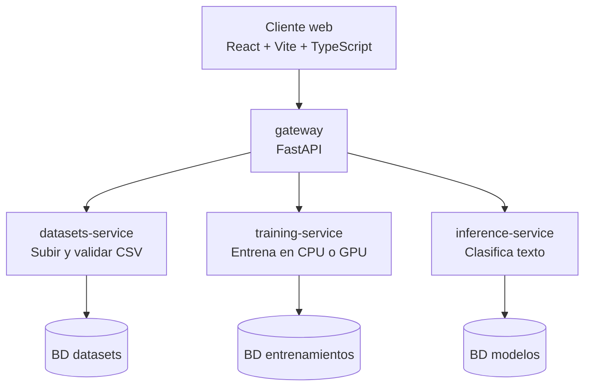
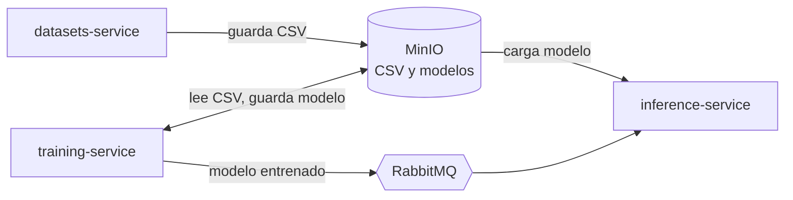

# PLAN.md — Arquitectura y plan de desarrollo

> Plan inicial. El proyecto se construye como **microservicios**, también con fines de aprendizaje.

## 1. Entorno detectado

- Windows 11, Python 3.14, Node 22, Git 2.54, GitHub CLI instalado.
- GPU: NVIDIA RTX 4050 Laptop (6 GB). Sirve para entrenar modelos pequeños y medianos.
- Python 3.14 es muy reciente y PyTorch podría no soportarlo aún: se usará un entorno virtual con 3.12 o 3.13 si hace falta.
- En Windows, Docker accede a la GPU mediante WSL2 y el NVIDIA Container Toolkit. Es lo más delicado de configurar, así que al inicio `training-service` puede correr directamente en la máquina y el resto en Docker.

## 2. Arquitectura

### Servicios y bases de datos

Cada microservicio es dueño de su base de datos; ningún otro servicio la toca directamente.

### Infraestructura compartida

- **MinIO**: almacén de archivos compatible con S3 para CSV y modelos.
- **RabbitMQ**: broker de mensajes. Cuando termina un entrenamiento, `training-service` publica un evento y `inference-service` lo recibe, sin que se llamen directamente.

## 3. Tecnologías

| Pieza | Elección |
|---|---|
| Cliente | React + Vite + TypeScript |
| Servicios | Python + FastAPI |
| Bases de datos | Una por servicio: SQLite al inicio, PostgreSQL después |
| Mensajería | RabbitMQ |
| Archivos | MinIO |
| ML clásico (CPU) | scikit-learn (TF-IDF + regresión logística) |
| ML profundo (GPU/CPU) | PyTorch + Hugging Face Transformers |
| Dispositivo | `torch.cuda.is_available()`: GPU si existe, CPU si no; se puede forzar CPU |
| Orquestación local | Docker Compose |

## 4. Responsabilidades

- **gateway**: único punto de entrada del cliente; enruta peticiones.
- **datasets-service**: subir, validar y listar CSV; detectar columnas y etiquetas.
- **training-service**: crear entrenamientos, ejecutarlos (worker) y llevar su estado y métricas.
- **inference-service**: cargar modelos entrenados y clasificar texto.

## 5. API (borrador, vía gateway)

- `POST /datasets` · `GET /datasets`
- `POST /jobs` · `GET /jobs` · `GET /jobs/{id}`
- `GET /models` · `POST /models/{id}/predict`

## 6. Lista de pendientes

**Base**
- [x] Estructura de carpetas (`services/`, `client/`, `infra/`) y `.gitignore`
- [x] Docker Compose con RabbitMQ y MinIO (`infra/docker-compose.yml`)

**gateway**
- [x] Servicio FastAPI con enrutado hacia los otros servicios (`services/gateway`)

**datasets-service**
- [ ] Subida y validación de CSV
- [ ] Guardado en MinIO y metadatos en su BD

**training-service**
- [ ] Creación de entrenamientos y estados (en cola, entrenando, terminado, fallido)
- [ ] Worker que consume la cola de RabbitMQ
- [ ] Entrenamiento scikit-learn en CPU
- [ ] Guardado de modelo en MinIO y métricas en su BD
- [ ] Publicación del evento de modelo entrenado
- [ ] Fine-tuning con Transformers y selección CPU/GPU

**inference-service**
- [ ] Consumo del evento y registro del modelo
- [ ] Carga del modelo desde MinIO y endpoint de predicción

**Cliente**
- [ ] Proyecto base y enrutado
- [ ] Pantalla Datasets (subir CSV, elegir columnas)
- [ ] Pantalla Entrenamientos (crear, elegir CPU/GPU, ver estados)
- [ ] Pantalla Clasificar (elegir modelo, escribir texto, ver resultado)

**Transversal**
- [ ] Pruebas automáticas por servicio
- [ ] Docker Compose completo, incluida la GPU

## 7. Ramas

Una rama por tarea, mergeada a `main`, con prefijos de tipo (`docs/`, `chore/`, `feat/`, `fix/`, `test/`).

| Rama | Contenido |
|---|---|
| `docs/readme-plan` | README y PLAN |
| `chore/estructura-proyecto` | Carpetas, `.gitignore`, Compose con RabbitMQ y MinIO |
| `feat/gateway` | Gateway FastAPI |
| `feat/datasets-service` | Servicio de datasets |
| `feat/training-service-cpu` | Entrenamiento en CPU con cola |
| `feat/inference-service` | Servicio de inferencia |
| `feat/client-base` | Cliente y pantallas |
| `feat/entrenamiento-gpu` | Transformers y selección CPU/GPU |

## 8. Fases

### Fase 1: funciona en una máquina normal
Todo corre en local (Docker Compose o procesos sueltos), sin cuentas ni costos en la nube.

### Fase 2: lista para AWS
Se despliega en servicios de AWS. Para que el salto sea sencillo, **la fase 1 se diseña ya pensando en ella**:

| Principio (aplica desde la fase 1) | Fase 1 (local) | Fase 2 (AWS) |
|---|---|---|
| Archivos mediante el protocolo S3, siempre detrás de una interfaz de almacenamiento | MinIO | Amazon S3 (solo cambian URL y credenciales) |
| Base de datos con SQLAlchemy y la URL en una variable de entorno | SQLite o PostgreSQL en Docker | Amazon RDS (PostgreSQL) |
| Mensajería detrás de una interfaz de publicación y consumo | RabbitMQ en Docker | Amazon MQ (RabbitMQ gestionado) o SQS |
| Un contenedor por servicio, configurado solo por variables de entorno | Docker Compose | ECS con Fargate |
| Entrada única con rutas por prefijo | gateway | Application Load Balancer o API Gateway |
| Entrenamiento con GPU en un contenedor separado | Tu RTX 4050 | EC2 con GPU o SageMaker |
| Cliente web estático | Servidor de desarrollo | S3 + CloudFront |
| Secretos fuera del código | Archivo `.env` | Secrets Manager |

Reglas para no cerrarnos puertas:
- Ningún servicio escribe en rutas del disco local: todo archivo va por la interfaz de almacenamiento.
- Ninguna dirección, usuario o contraseña va escrito en el código: todo sale de variables de entorno.
- Ningún servicio lee la base de datos de otro.
- Los servicios no guardan estado propio: se pueden apagar y volver a levantar sin perder nada.

## 9. Decisiones pendientes

1. SQLite o PostgreSQL desde el inicio.
2. Si los archivos se guardan en MinIO desde la primera rama de datasets, o en una carpeta local detrás de la interfaz de almacenamiento y MinIO después.
