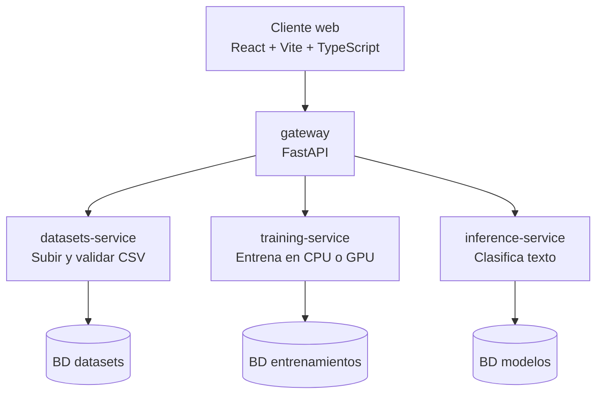
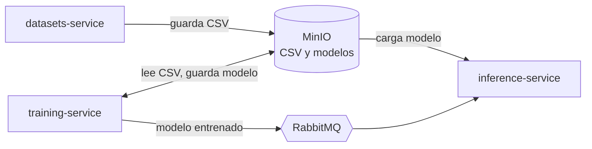

# entrenaModelos

Plataforma web para **entrenar y usar modelos de clasificación de texto** sin escribir código: subes tus datos, pides un entrenamiento, sigues su avance y luego usas el modelo resultante desde el mismo sitio.

## Propósito

Dado un conjunto de ejemplos de texto con su etiqueta (por ejemplo, un CSV con columnas `texto` y `categoria`), el sistema entrena un modelo que aprende a clasificar textos nuevos. Una vez entrenado, el usuario le envía un texto y el modelo responde con la clasificación que le corresponde.

## Flujo completo

1. **Subir datos**: el usuario carga un archivo CSV desde la interfaz web.
2. **Registrar el entrenamiento**: se crea una petición de entrenamiento (nombre, columnas de texto y etiqueta, dispositivo CPU/GPU).
3. **Seguir el estado**: la interfaz muestra los entrenamientos y su estado (en cola, entrenando, terminado, fallido), con métricas básicas.
4. **Usar el modelo**: desde el mismo sitio, el usuario elige un modelo entrenado, escribe un texto y obtiene la clasificación (y su confianza).

## Requerimientos

- Interfaz web (cliente) para todo el flujo: subir datos, entrenar, monitorear y clasificar.
- Entrenamiento en **CPU o GPU**, usando la GPU automáticamente si la máquina la tiene disponible.
- Los entrenamientos corren en segundo plano, sin bloquear la interfaz.
- Los modelos entrenados se guardan y pueden reutilizarse en cualquier momento.

## Arquitectura

El proyecto se construye como microservicios. Cada servicio tiene su propia base de datos.



Los servicios comparten archivos (MinIO) y se avisan por mensajes (RabbitMQ):



Detalle de tecnologías, pendientes y ramas en [PLAN.md](PLAN.md).

## Estructura del repositorio

```
client/      Cliente web (React)
services/    Microservicios: gateway, datasets-service, training-service, inference-service
infra/       Docker Compose con RabbitMQ y MinIO
```

Para levantar la infraestructura compartida:

```bash
cd infra
cp .env.example .env   # y cambia las contraseñas
docker compose up -d
```

## Estado del proyecto

Fase inicial: definición de objetivos y arquitectura. La tecnología y el plan de desarrollo se documentarán en `PLAN.md`.

## Forma de trabajo

- Una **rama por tarea** (`feat/...`, `fix/...`, `docs/...`), integradas a la rama principal mediante merge.
- Commits pequeños con mensajes en estilo [Conventional Commits](https://www.conventionalcommits.org/) (`feat:`, `fix:`, `docs:`, `chore:`).
- Los avances se publican en un repositorio de GitHub.
